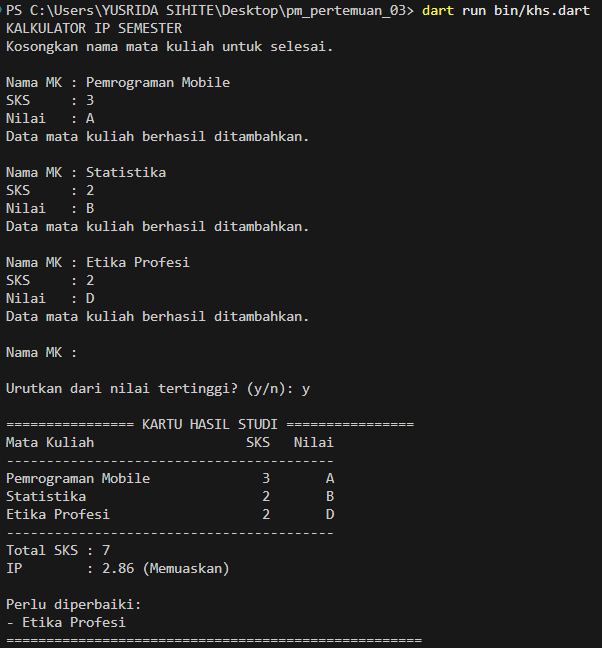
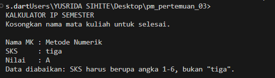

# Tugas Rutin 3 — Kalkulator IP Semester

## Identitas

- **Nama:** Yusrida Jelianti Sihite
- **NIM:** 4243250048
- **Kelas:** PSIK 24C
- **Mata Kuliah:** Pemrograman Mobile

## Deskripsi

Program console berbasis Dart untuk menghitung Indeks Prestasi (IP) semester berdasarkan nama mata kuliah, jumlah SKS, dan nilai huruf. Program melakukan validasi input, menghitung IP berbobot, menampilkan Kartu Hasil Studi (KHS), serta menunjukkan mata kuliah yang perlu diperbaiki. Pengguna juga dapat mengurutkan KHS berdasarkan bobot nilai tertinggi.

## Screenshot Pengujian

### 1. Input Valid

Simpan screenshot di `screenshots/input-valid.png`.

### 2. Input Tidak Valid

Simpan screenshot saat SKS diisi `tiga` atau nilai huruf tidak valid di `screenshots/input-tidak-valid.png`.

## Higher-Order Function dan Error Handling

Program ini menggunakan higher-order function pada fungsi `hitungIp()`, `cetakKhs()`, dan `main()`. Fungsi `fold()` digunakan dalam `hitungIp()` untuk menjumlahkan total SKS dan total bobot nilai secara bertahap. Fungsi `where()` pada `cetakKhs()` memilih mata kuliah dengan bobot kurang dari 2, sedangkan `sort()` menggunakan fungsi pembanding untuk mengurutkan mata kuliah berdasarkan bobot nilai tertinggi. Parameter bernama `urutkan` pada `cetakKhs()` menentukan apakah daftar KHS akan diurutkan.

Error handling diterapkan pada fungsi `validasi()` dan `bobot()`. Kedua fungsi melempar `FormatException` apabila SKS berada di luar rentang 1–6 atau nilai huruf tidak termasuk A, B, C, D, dan E. Di dalam `main()`, exception ditangkap menggunakan `on FormatException catch (e)` sehingga input yang tidak valid diabaikan tanpa menghentikan program. Dengan demikian, pengguna dapat melanjutkan memasukkan mata kuliah lainnya.

## Penggunaan AI

AI digunakan sebagai alat bantu untuk memahami struktur program Dart, penggunaan higher-order function.